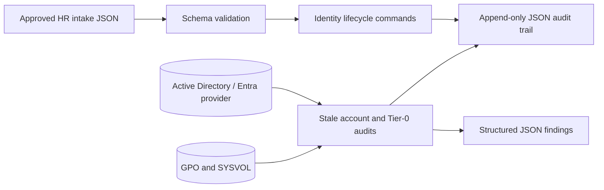

# IT AD Automator

[](https://github.com/drummer475-94/it-ad-automator/actions/workflows/test.yml)
[](https://github.com/drummer475-94/it-ad-automator/actions/workflows/test.yml)
[](https://learn.microsoft.com/powershell/)
[](LICENSE)

Production-oriented PowerShell automation for Active Directory identity lifecycle, stale-account review, Tier-0 privilege hygiene, GPO auditing, and domain health checks. Mutating commands support `-WhatIf`; secrets are supplied as `SecureString` or credentials and are never embedded in source or intake files.

## 60-second review

1. Open [`IdentityLifecycle.psm1`](powershell/Modules/IdentityLifecycle.psm1) to see validated onboarding, department RBAC assignment, offboarding, and role changes.
2. Open [`PrivilegeAudit.psm1`](powershell/Modules/PrivilegeAudit.psm1) for inactive-user, disabled-account group retention, non-expiring password, nested Domain Admin, unconstrained delegation, and Tier-0 separation findings.
3. Open [`GPOAudit.psm1`](powershell/Modules/GPOAudit.psm1) for unlinked GPO, excessive ACL, Group Policy Preferences `cpassword`, SMBv1, and NTLMv1 checks.
4. Run the fully mocked Pester suite: no domain or RSAT installation is required.

## Data flow



## Quick start

```powershell
Import-Module ./powershell/ITADAutomator.psd1 -Force

# Preview onboarding. WhatIf does not require a password because it performs no mutation.
New-ADUserAutomated -IntakeJsonPath ./examples/new-hire.json -WhatIf

# For an approved change, acquire the password interactively as a SecureString.
$initialPassword = Read-Host 'Initial one-time password' -AsSecureString
New-ADUserAutomated -IntakeJsonPath ./examples/new-hire.json -InitialPassword $initialPassword

Invoke-StaleAccountAudit -InactiveThresholdDays 90
Test-DomainAdminHygiene -TierZeroOU 'OU=Tier 0'
Get-GPOAuditReport -Domain 'corp.local'
```

`Disable-ADUserOffboard` removes non-primary group memberships and disables the account. Session revocation uses `Revoke-MgUserSignInSession` when Microsoft Graph is installed, or a caller-supplied `-SessionRevocationHandler`; both receive the account's `UserPrincipalName`. The result reports `SessionsRevoked = false` when no provider is configured instead of claiming success. A revocation or group-removal failure does not stop the account from being disabled: the result is `PartiallyOffboarded` with `GroupsFailed` and `Errors` populated, and `OffboardFailed` (plus a PowerShell error) when the account could not be disabled.

`New-ADUserAutomated` refuses to create an account when the derived `SamAccountName` or UPN already exists, so a name collision can never grant the new hire's baseline group to someone else's account.

Audit commands do not report a clean result when they could not look: `Get-GPOAuditReport` returns `ComplianceStatus = Incomplete` with `ScanErrors` when GPOs or SYSVOL cannot be read, and `Invoke-ADHealthCheck` reports `InactiveSearchStatus = Failed` and at least `Warning` when the inactive-account search fails.

## Safety model

- No hardcoded passwords, tokens, tenant IDs, or domain credentials.
- `SecureString` for initial passwords and `PSCredential` for alternate AD credentials; named secrets can be retrieved from PowerShell SecretManagement.
- `SupportsShouldProcess` (`-WhatIf` / `-Confirm`) on lifecycle mutations.
- JSON intake allowlist validation and sanitized account-name construction.
- Structured audit and finding exports contain operational metadata, not credentials.
- Test-only RSAT command shims live under `powershell/Tests`, are loaded only by the test suite, and declare the real cmdlets' parameter names so a misspelled parameter fails in tests.

## Verification

```powershell
$result = Invoke-Pester -Path ./powershell/Tests -CodeCoverage ./powershell/Modules/*.psm1 -PassThru
$coverage = 100 * $result.CodeCoverage.NumberOfCommandsExecuted / $result.CodeCoverage.NumberOfCommandsAnalyzed
'Coverage: {0:N2}%' -f $coverage
```

The current suite contains 40 offline-safe tests. CI runs the compatibility suite with Pester 4.10.1 on PowerShell 7, calculates command coverage on every change, and requires greater than 90%.

## License

MIT. See [LICENSE](LICENSE).
